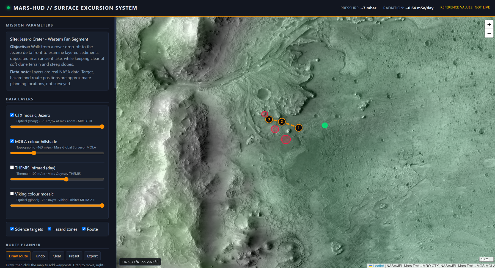
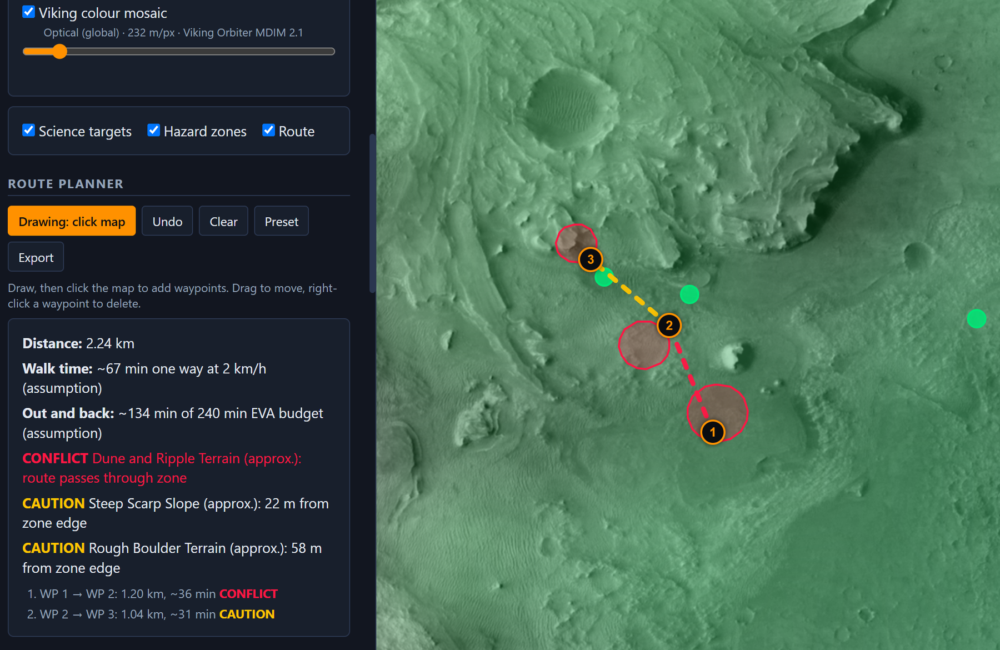
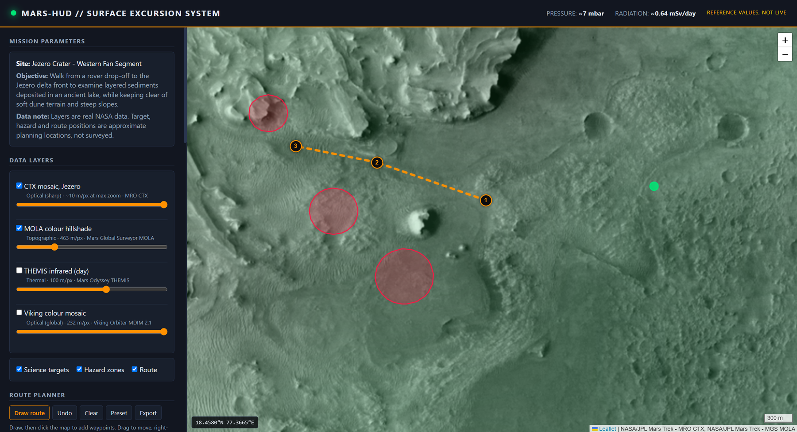
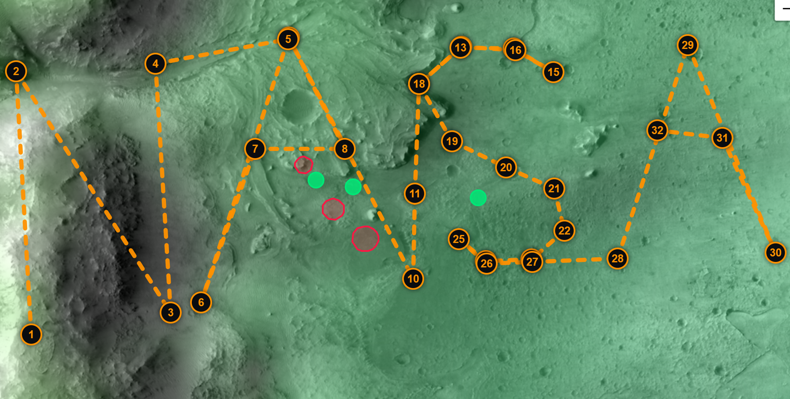

# Marswalk: Jezero EVA Planner
 
An interactive map for planning a safe astronaut walk on Mars. Marswalk layers
real NASA orbital data on a single map and checks a planned route against
hazard zones in real time.
 

 
## The problem
 
Mission planners and crews need to see terrain, science targets and danger
zones together. Today that usually means switching between separate tools.
Marswalk puts them in one view and gives instant feedback while a route is
being edited, so a path that clips a boulder field or a steep slope is
obvious immediately.
 
## Features
 
- **Four NASA data layers**, stackable with per-layer opacity:
  MRO CTX (high-detail terrain imagery), MGS MOLA (elevation hillshade),
  Odyssey THEMIS (thermal infrared) and Viking MDIM 2.1 (global colour).
- **Science targets and hazard zones.** Targets are the delta scarp front,
  a mid-fan outcrop and the Perseverance landing site as a ground-truth
  reference. Hazards are dune and ripple terrain, a steep scarp slope and
  boulder terrain, each drawn as a true-radius circle. Layer toggles and
  click-to-fly cards make them quick to inspect.
- **Route planner.** Add waypoints, drag them, right-click to delete, undo,
  clear, reset to the preset route, or export the route as GeoJSON. The
  route is remembered in the browser between visits.
- **Live route analysis.** Distance, estimated walking time and clearance
  from every hazard, reported as `CLEAR`, `CAUTION` or `CONFLICT`. Each leg
  of the route is coloured by its worst status.
- **EVA time budget.** Out-and-back time is compared against the budget and
  flagged `OVER BUDGET` when exceeded.
- **NASA surface imagery.** Perseverance and Jezero photos from the NASA
  Image and Video Library, cached and loaded after first paint. If NASA is
  unreachable the app reports "unavailable"; it never substitutes fake
  images.
- Responsive layout and keyboard-accessible controls.
## Screenshots
 
### Hazard conflict detection
 
When a route enters a hazard zone, the affected leg turns red and the
readout reports `CONFLICT`. Routes that pass within the 100 m caution
buffer are marked `CAUTION`. Here the route crosses dune and ripple terrain
and passes close to the other two hazards.
 

 
### Layers, targets and hazards
 
Close-up of the CTX imagery blended with MOLA elevation. Hazard zones are
shown as red circles, the Perseverance landing reference as a green marker,
and the planned route as numbered waypoints. The sidebar controls layer
visibility and opacity.
 

 
### Free-form routes
 
The planner places no limit on waypoints. This route uses 32, and every leg
is analysed against the hazards as it is drawn or moved.
 

 
## Data sources
 
| Layer | Mission / instrument | Resolution | Use |
|---|---|---|---|
| CTX mosaic, Jezero | Mars Reconnaissance Orbiter CTX | ~10 m/px at max zoom | Detailed terrain |
| MOLA colour hillshade | Mars Global Surveyor MOLA | 463 m/px | Elevation context |
| THEMIS infrared (day) | Mars Odyssey THEMIS | 100 m/px | Thermal context |
| Viking colour mosaic | Viking Orbiter MDIM 2.1 | 232 m/px | Global colour context |
| Surface photos | NASA Image and Video Library | n/a | Ground-level imagery |
 
Map tiles are served by NASA/JPL Mars Trek. Positions and distances are
computed on a Mars-radius sphere (3,396,190 m), not Earth's.
 
## Getting started
 
```bash
python -m venv .venv
source .venv/bin/activate        # Windows: .venv\Scripts\activate
pip install -r requirements.txt
python app.py                    # http://127.0.0.1:5000
```
 
No API key is required.
 
Other commands:
 
```bash
FLASK_DEBUG=1 python app.py      # development mode (never in production)
gunicorn "app:create_app()"      # production
pytest                           # run the tests
```
 
Optional environment variables: `HOST`, `PORT`, `LOG_LEVEL`,
`IMAGERY_TTL_SECONDS`.
 
## Architecture
 
The backend defines the mission once and the frontend renders exactly what
the API returns, so nothing is duplicated between Python and JavaScript.
 
| File | Purpose |
|---|---|
| `mission_data.py` | Single source of truth: layers, targets, hazards, route |
| `planning.py` / `geo.py` | Route length, EVA time and hazard clearance (Mars radius) |
| `imagery.py` | Cached NASA Image Library client; never fabricates images |
| `app.py` | Flask application factory and API |
| `templates/index.html` | Page shell |
| `static/app.js` / `static/style.css` | Map, sidebar and route logic; styling |
| `tests/test_app.py` | Backend tests |
 
### API
 
| Endpoint | Returns |
|---|---|
| `GET /api/v1/mission` | Mission definition plus computed route analysis |
| `GET /api/v1/imagery` | Cached NASA imagery with status |
| `GET /api/v1/status` | Service health |
 
## Limitations
 
- Science targets, hazard zones and the preset route are **approximate
  planning locations** around the Jezero delta, placed from published
  descriptions of the area. They are not surveyed or derived from CRISM or
  HiRISE products. Only the Perseverance landing site is a known reference
  point.
- Walking speed (2 km/h), the 100 m caution buffer and the 240-minute EVA
  budget are **planning assumptions**, not measured values.
- The pressure and radiation figures in the header are published reference
  values (MSL REMS and RAD) and are labelled as not live.
- Radiation exposure is not yet modelled for a route. The hazards modelled
  are terrain hazards: soft dunes, steep slopes and boulders.
## Roadmap
 
- Radiation zones with per-zone dwell-time limits and route exposure
  estimates
- Slope-aware auto-routing from MOLA elevation
- HiRISE close-up layer
- Real target and hazard coordinates from published CRISM and HiRISE
  products
- Photos linked to each science target
## Credits
 
Map tiles: NASA/JPL Mars Trek. Imagery: NASA Image and Video Library.
Mapping: [Leaflet](https://leafletjs.com/).
 
